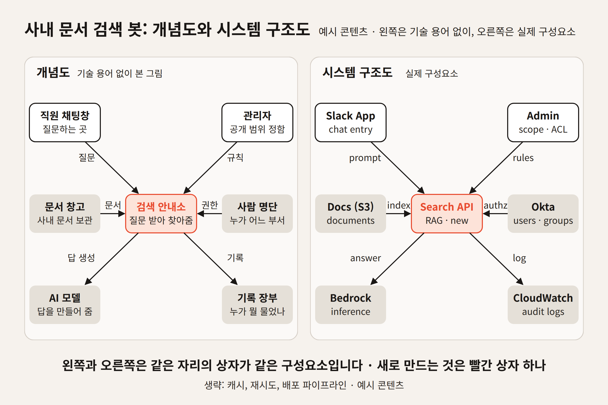
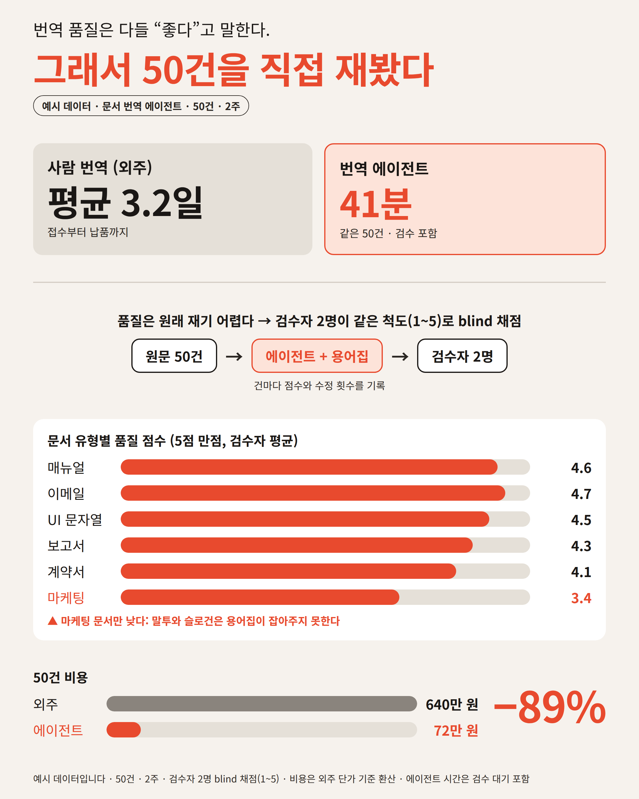
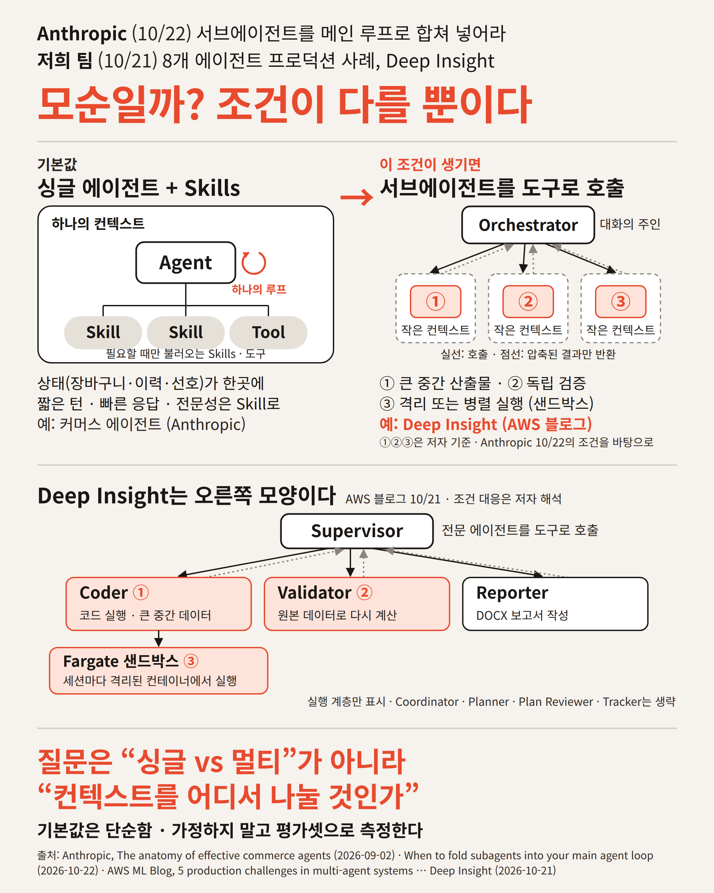

# infographic-design plugin

LinkedIn·피드 포스팅에 첨부할 **인포그래픽 이미지 1장**을 만드는 플러그인입니다. 글자를 가려도 모양만으로 뜻이 남고, 리포스트되어 본문이 잘려도 메시지가 살아남는 이미지를 목표로 합니다.

| 스킬 | 종류 | 역할 |
|---|---|---|
| **[infographic-mindset](skills/infographic-mindset/SKILL.md)** | 판단 기준 | 이미지가 필요한 경우, 3가지 테스트, 색 역할과 타입 스케일, 설계 도식 3종. *무엇이* 좋은 인포그래픽인가 |
| **[infographic-build](skills/infographic-build/SKILL.md)** | 빌드 도구 | 토큰 CSS, 템플릿 3종, 렌더·린트 스크립트, 결함표. *어떻게* PNG를 만드는가 |

둘은 따로 써도 되고 같이 써도 됩니다. `deck-design` 플러그인과 같은 구조(mindset / build)입니다.

## 언제 어느 것을

| 상황 | 스킬 |
|---|---|
| 포스팅은 있는데 이미지를 붙일지, 무엇을 그릴지 정하는 단계 | **infographic-mindset** (이미지가 필요한가 → 도식 고르기 → ASCII 목업) |
| 목업이 승인됐고 PNG를 만들어야 함 | **infographic-build** (템플릿 복사 → 렌더 → 린트 → 직접 보기 → 결함표) |
| 이미 만든 이미지가 "글자가 너무 많다 / 작은 글자가 안 보인다"는 피드백을 받음 | **infographic-build** `scripts/lint.py` 로 수치 확인 후 **mindset** 의 예산·타입 스케일로 수정 |
| 참고 이미지의 색을 그대로 쓰고 싶음 | **infographic-build** `scripts/sample_colors.py` 로 팔레트 추출 → `tokens.css` 교체 |

## 설계 도식 3종

실제로 게시된 이미지에서 뽑은 레이아웃입니다. 메시지가 무엇으로 이루어졌는지로 고릅니다.

| 도식 | 메시지의 재료 | 캔버스 | 예시 |
|---|---|---|---|
| **A · 개념도·구조도 2단** | 비기술·기술 독자가 같이 알아봐야 하는 아키텍처 | 1200×800 가로 |  |
| **B · 질문 + 측정 카드 + 막대** | 직접 잰 숫자 | 1080×1350 세로 |  |
| **C · 긴장 헤드라인 + 구조 비교 + 실루엣 대응** | 두 접근을 비교하는 주장과 실제 사례 | 1080×1350 세로 |  |

자세한 띠 구성과 규칙: [skills/infographic-mindset/reference/schemes.md](skills/infographic-mindset/reference/schemes.md)

## 작업 순서

1. **이미지가 필요한지 판단** — 본문이 잘려도 남아야 할 한 문장이 있는가, 모양으로 보여줄 구조·숫자가 있는가.
2. **도식 선택과 ASCII 목업** — 띠 단위로 문구까지 적어 승인받습니다. 승인 전에는 HTML을 쓰지 않습니다.
3. **템플릿 복사 → HTML 작성** — 색과 크기는 `tokens.css` 만 씁니다. SVG 도형은 `base.css` 의 `s-*` 클래스를 씁니다.
4. **렌더 → 린트 → 직접 보기** — `render.py` 가 PNG 와 보고서(글자 수, 최소 크기, 색, 넘침)를 만들고 `lint.py` 가 판정합니다. 통과해도 PNG 를 열어 봅니다. 화살촉이 떨어지거나 상자가 겹치는 결함은 숫자로 안 잡힙니다.
5. **결함표 대조 → 재렌더** — [reference/defects.md](skills/infographic-build/reference/defects.md) 의 12가지를 확인합니다.

```bash
cd skills/infographic-build
cp templates/scheme-c-structure-compare.html /path/to/post/my-image.html   # tokens.css, base.css 도 같이 복사
python3 scripts/render.py /path/to/post/my-image.html /path/to/post/my-image.png      # 1080x1350, 2배
python3 scripts/lint.py /path/to/post/my-image.report.json --source /path/to/post/my-image.html --budget 650   # 예산: 도식 A 400 · B 450 · C 650
```

가로형(도식 A)은 `--width 1200 --height 800` 으로 렌더합니다.

## 필요한 환경

- Python 3 + `playwright` (Chromium 포함: `python3 -m playwright install chromium`). 스크립트는 `python3` 로 실행합니다. `python3 -I` 는 사용자 site-packages 를 못 봐서 playwright 를 찾지 못합니다.
- 한글 폰트 `Noto Sans CJK KR` (Linux: `fonts-noto-cjk`). 없으면 토큰의 `--font` 를 바꿉니다.
- Pillow 는 필요 없습니다. 색 추출도 Chromium 캔버스로 합니다.

## 설치

```
/plugin install infographic-design --marketplace gonsoomoon-ml/claude-extensions
```

(Claude Code 2.1.275 이전 버전은 `/plugin marketplace add gonsoomoon-ml/claude-extensions` 후 `/plugin install infographic-design@gonsoomoon-extensions`.)

## 기원

2026-10-24, "싱글 vs 멀티 에이전트" LinkedIn 포스팅의 첨부 이미지를 만들면서 정리했습니다. 글자 카드 위주의 1차안이 "일반적인 인포그래픽 기준에 맞는가"라는 질문에 흐림 테스트를 통과하지 못해 구조 그림으로 바꿨고, 작은 글자가 연회색이라 안 보인다는 피드백으로 색 규칙이 생겼습니다. 그 과정에서 실제로 겪은 결함이 [defects.md](skills/infographic-build/reference/defects.md) 에, 스킬 없이 만든 기준선과 스킬을 적용한 결과의 비교가 [lessons.md](skills/infographic-mindset/lessons.md) 에 있습니다.
